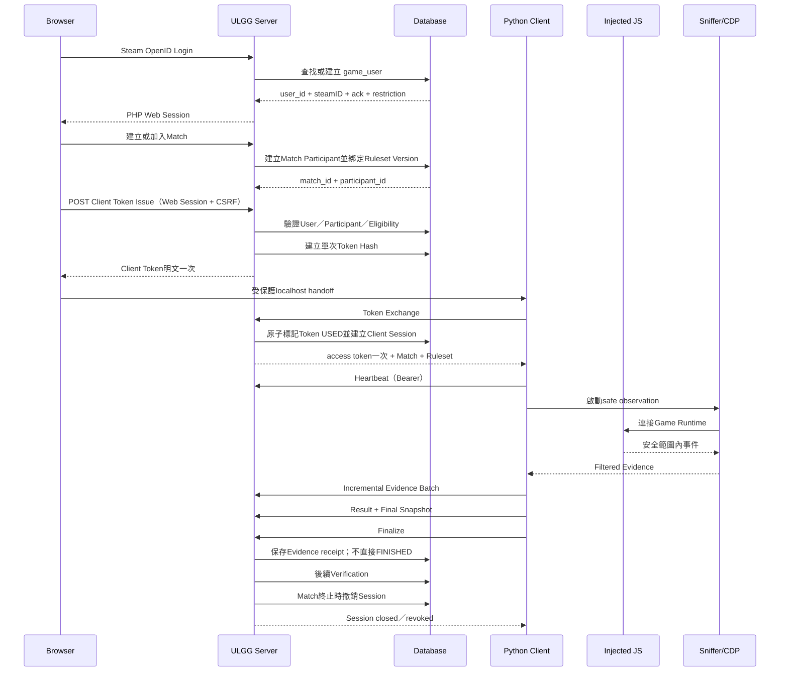

# Phase 1 Client Authentication Contract v0.1

日期：2026-07-29

狀態：Proposed Contract Freeze

適用對象：ULGG Website、ULGG Server、Python Client、CDP／Sniffer、Custom Match 系統

契約基準：Phase 1 Architecture Freeze、Client Integration Contract、Migration Scope Decision、Database Naming Freeze

本文件只定義身份權威、Token、Client Session、概念 API、Evidence Envelope 與安全邊界。它不是 API 實作、資料庫 migration、Evidence Verification Engine 或反作弊保證。

## 1. Executive Summary

ULGG 現有 Steam Login 已能把 Steam 驗證結果綁到 `game_user.id`，但它建立的是瀏覽器內的 PHP Web Session。PHP Session ID、Steam Cookie 與 `ulgg_remember` 都是網站憑證，生命週期、撤銷方式及暴露面不適合交給 Python Client，更不能放入 Injected JavaScript。

Client Authentication 採兩段式：

1. 已登入的 Browser 針對指定 Match Participant 申請一次性 Client Token。
2. Python Client 用該 Token 交換短效 Client Session，之後以 Client Session Bearer Secret 執行 heartbeat、Evidence upload、finalize。

一次性 Client Token 解決「如何把既有網站身份安全地交接給本機 Client」；短效 Client Session 則提供可撤銷、可稽核、綁定 Match／Participant／Ruleset 的執行期授權。兩者都不能取代 Steam Login，也不能讓 Client 自行宣告可信的 `steam_id`、`user_id` 或 Participant。

Client Evidence 是某個已認證 Client 的觀測資料，不是結果權威。ULGG Server 必須依 Client Session 反查身份與 Match，並在後續 Verification 階段比對雙方、Sniffer、Ruleset 與 Game Server observation。Client 上傳 `winnerSide` 或 `finishedAt` 不會直接把 Match 改為 `FINISHED`。

## 2. Scope

### 2.1 Phase 1 Contract包含

- 既有 Steam Login 與 Session 事實。
- Identity Authority。
- Client Token契約。
- Client Session契約。
- Eligibility Policy。
- 概念 API與Error Contract。
- Evidence Envelope。
- Upload、Idempotency及Retry策略。
- Security Contract。
- `game_user`相容性分析。
- Auth領域概念資料模型。
- Audit Event。

### 2.2 本階段不包含

- PHP、Python或JavaScript實作。
- Auth API endpoint。
- 資料庫migration或schema異動。
- `match_client_bindings`、`client_evidence`、`match_verification_results`或`match_arena_mapping`實體表。
- Evidence Verification Engine。
- Client binary signing或device attestation。
- Anti-cheat保證。
- Full Replay Storage或Replay UI。
- Custom BP計算。
- Injected JavaScript身份驗證。

## 3. Existing System Findings

本節是已確認事實，不是Open Question。

### 3.1 Steam Login入口與Callback

- `layout/base.php` 約5581–5592行：未登入Header顯示Steam登入，導向 `/api/auth/steam_start.php`。
- `pages/login.php` 約64–93行：獨立登入頁使用相同入口。
- `api/auth/steam_start.php` 約3–32行：啟動Session、保存 `login_redirect`、建立Steam OpenID請求。
- `api/auth/steam_callback.php` 約116–246行：檢查Callback欄位、17碼Steam ID、nonce時間、Steam簽章及nonce重播。
- `api/auth/steam_callback.php` 約248–322行：依 `game_user.steamID` 查找或建立帳號並更新Session。

流程：

```text
Browser
→ /api/auth/steam_start.php
→ Steam OpenID
→ /api/auth/steam_callback.php
→ game_user
→ PHP Web Session
```

### 3.2 Session實際內容

`api/auth/steam_callback.php` 約264–321行在登入成功後先執行 `session_regenerate_id(true)`，再保存：

```text
user_id
steam_id
username
nickname
ack
permission
apply
user_region
view_server
steam_name
steam_avatar_full
steam_profile
is_new_user（只有新帳號）
```

其中：

```text
$_SESSION['user_id']  = game_user.id
$_SESSION['steam_id'] = game_user.steamID
```

### 3.3 Session期限與Remember Login

- `config.php` 約73–86行：Web Session Cookie與 `gc_maxlifetime` 設為86400秒，約24小時。
- `config.php` 約129–163行：若Session缺少 `user_id`，可由 `ulgg_remember` 查 `user_remember_tokens` 恢復登入。
- `api/auth/steam_callback.php` 約381–416行：Remember Token有效期30天。
- Remember Token目前以原值保存，不能交給Python Client或重用為Client Token。
- Header呼叫的 `/api/auth/remember_flag.php` 目前不存在，因此Remember Me可能總是依Callback預設啟用。
- Remember自動登入沒有恢復 `apply`。

### 3.4 登出

- `pages/logout.php` 約1–33行：移除本裝置Remember Token、清Cookie、銷毀本裝置PHP Session。
- `pages/logout_all.php` 約1–38行：刪除該User所有Remember Token並銷毀本裝置PHP Session。

「登出所有裝置」不會立即撤銷其他裝置已建立的PHP Session。因此Client Session必須有自己的 `expires_at`、`revoked_at`、`closed_at`、`last_seen_at` 與 `session_status`。

### 3.5 權限檢查

- `layout/base.php` 約5377–5381行：`steam_id`代表Steam Login；`ack >= 1`代表已驗證UL User。
- `pages/admin/_admin_gate.php` 約3–10行：`permission >= 2`才能進入管理功能。
- `api/auth/steam_callback.php` 將 `permission` 設為 `ack`。
- 專案目前沒有統一Authentication／Authorization Middleware，各頁自行檢查Session。
- `pages/admin/ajax/user_block.php` 約81–91行定義 `black_list`：0正常、1觀察中、2封鎖。
- Profile與Admin對 `black_list = 1` 的呈現語意不完全一致；本次不修正。

### 3.6 game_user實際資料

2026-07-29透過既有 `config.php` 連線執行唯讀查詢：

| 項目 | 結果 |
|---|---:|
| `game_user`總數 | 421 |
| 有效Steam ID | 143 |
| 未綁定Steam ID | 278 |
| 重複Steam ID群組 | 0 |
| 非NULL空字串 | 0 |
| 非17碼數字 | 0 |
| `ack = 0` | 60 |
| `ack = 1` | 78 |
| `ack = 2` | 4 |
| `ack = 3` | 1 |
| `black_list IS NULL` | 95 |
| `black_list = 0` | 48 |
| `black_list IN (1,2)` | 0 |

`steamID`目前沒有UNIQUE Constraint或一般Index。既有資料乾淨，但Callback的「先SELECT、找不到再INSERT」在併發登入時仍可能產生重複。

## 4. Frozen Decisions

1. ULGG Steam Login是網站身份權威。
2. `game_user.id`是ULGG內部User Identity。
3. `game_user.steamID`是已驗證Steam External Identity。
4. Match Participant的FK使用 `game_user.id`。
5. Client不建立另一套User Account。
6. Client不能自行宣告可信的Steam ID、ULGG User ID或Participant。
7. Server依Token／Client Session反查User、Participant與Match。
8. 身份驗證不放在Injected JavaScript。
9. Injected JavaScript只做遊戲Runtime、Ruleset／COST套用及必要資料取得。
10. Python Client負責Client Authentication、CDP／Sniffer協調、Evidence收集與上傳。
11. PHP Session ID、Remember Token、Steam Cookie與OpenID資料不得交給Client。
12. 不提供永久Refresh Token。
13. ULGG Match建立時已決定Match Identity、Participants與Ruleset Version。
14. `ulgg_match_id`是ULGG對外主要Match Identity。
15. Game Server Room ID是Observation，不是Match主Identity。
16. Ruleset Version與Hash由Server提供。
17. Evidence不等於Verification。
18. `FINISHED`代表Server驗證並接受。
19. Phase 1只凍結Contract，不實作完整Verification。

## 5. Actors and Trust Boundaries

| Actor | 可相信 | 不可直接相信 | Authority／Observation | Secret處理與Server要求 |
|---|---|---|---|---|
| Browser | 已由PHP Session解析的網站User | Browser提交的User ID、Match Participant ID | 網站互動端；非身份資料庫 | Web Session Cookie只留Browser；Issue Token需CSRF與Server反查 |
| ULGG Website | Server渲染的登入狀態 | URL或表單中自報身份 | Client Token申請介面 | 不在HTML、URL或Log渲染Token Secret |
| ULGG Server | Steam callback驗證、DB關聯、Auth狀態 | Client自報Steam ID、winner或Ruleset合法性 | Identity、Token、Session、Match Binding權威 | 只保存Secret Hash；常數時間比較；完整Audit |
| PHP Web Session | `user_id`與 `steam_id` 綁定結果 | 其他裝置或過期Session | Browser登入證明 | 不可轉交Python；不作Client Bearer Token |
| Python Client | 自己的版本、安裝ID及安全解析後Observation | 自報User、Participant、Official資格、winner權威 | Evidence producer | Bearer Secret只留Python程序／受保護本機儲存 |
| Injected JavaScript | Game Runtime內可見的安全資料 | 任何身份Secret、對手隱藏資訊 | Game observation／操作層 | 不得接觸Token、Cookie、Steam secret或access token |
| CDP | 本機Game Runtime事件來源 | 任意frame都不天然安全 | Observation channel | 只連127.0.0.1；先經safe parser再交Python |
| Sniffer | 安全邊界內事件 | raw packet、隱藏資訊及未驗證結果 | Evidence collector | 不上傳restricted payload；不保存Token |
| Game Client | Game Server傳來的可見狀態 | 本機可修改UI或注入結果 | Observation | 不作身份或Official資格權威 |
| Game Server | 實際Room與戰鬥機制 | 目前尚無簽章Report契約 | 遊戲結果的原始Authority | 由Client／watcher觀測；Server仍需交叉驗證 |
| Match Participant | Browser登入後的操作意圖 | 口頭宣稱、玩家名稱 | 被ULGG Match綁定的角色 | 必須由Server透過User與Participant關聯確認 |

安全邊界：

```text
Steam → ULGG Web Session → 一次性Client Token → 短效Client Session
```

每次跨越邊界都必須縮小scope，不得把上一層憑證原封不動向下傳。

## 6. Identity Authority Model

| 欄位 | 用途 | 是否身份權威 | 注意 |
|---|---|---|---|
| `game_user.id` | ULGG內部User FK | 是 | Match Participant、Token、Session都綁定它 |
| `game_user.steamID` | 已驗證Steam外部身份 | 是，僅限外部映射 | 應唯一；不得由Client自報 |
| `game_user.username` | ULGG／UL遊戲帳號資料 | 否 | 可變、可能跨Region重複；不能取代User ID |
| `game_user.friend_code` | 輔助人工或遊戲帳號驗證 | 否 | 不是登入憑證 |
| `steam_username` | 顯示資訊 | 否 | 可由Steam使用者更改 |
| 遊戲內顯示名稱 | Match observation | 否 | 可重複、變更或與ULGG username不同 |
| `ulgg_match_id` | 對外Match Identity | 是 | 由Server產生 |
| Participant ID | Match內席位Identity | 是 | 由Server依Match Participant產生 |
| Game Server Room ID | 遊戲房Observation | 否 | 只作reconciliation evidence |

## 7. Client Token Contract

### 7.1 用途與建立時機

Client Token是Browser Web Session與Python Client之間的一次性交接憑證。只有玩家已建立或加入Match、且Server已確認 `game_user.id` 對應該Participant後才能發行。

Client Token不能用於Evidence Upload。它唯一可執行的動作是Exchange成Client Session。

### 7.2 Token格式

建議格式：

```text
ct_<publicTokenId>.<256-bit random secret>
```

- `ct_`：明確的Token類型prefix。
- `publicTokenId`：可安全記錄、全域唯一的公開識別。
- secret：CSPRNG產生至少256-bit entropy，使用URL-safe encoding。
- Server只保存secret的SHA-256或具Server pepper的HMAC-SHA-256。
- 明文只在發放成功回應中出現一次。
- Log、HTML、URL、Query String、Error、Audit metadata不得包含明文。

高entropy Token即使只用SHA-256也足以抵抗離線暴力；加入Server pepper可降低資料庫外洩後的關聯風險。v0.1推薦HMAC-SHA-256並版本化pepper key。

### 7.3 綁定資料

Token必須綁定：

- `user_id`
- `match_id`
- `participant_id`
- `ruleset_version_id`
- Server決定的scope
- 發行時的Eligibility結果
- `issued_by_user_id`

Token不接受Client提供上述Identity作為權威。Exchange只依Token紀錄反查。

### 7.4 Lifecycle

受控狀態：

```text
ISSUED
USED
EXPIRED
REVOKED
```

建議欄位：

- public token ID
- token prefix
- token hash
- user／match／participant／ruleset version FK
- `scope_json`
- token status
- `created_at`
- `expires_at`
- `used_at`
- `revoked_at`
- `revoke_reason_code`
- `issued_by_user_id`

### 7.5 時效與單次使用

- TTL：30分鐘。
- 首次成功Exchange後立即原子地改為 `USED`。
- 過期後不能Exchange。
- Match不再可加入、Participant被移除或帳號受限時立即撤銷。
- 不提供續期。

### 7.6 同時有效Token與重發

v0.1推薦：

```text
同一Participant／Match最多一枚ISSUED且未過期Token
重新發行時先撤銷舊Token
```

優點：

- 降低Token分享與忘記撤銷的風險。
- UI與Audit較容易理解。
- 避免兩部Client同時Exchange。

缺點：

- Browser重複點擊可能讓尚未交接的Token失效。
- 多裝置切換需要重新發行。
- Issue回應遺失時無法再次取回同一明文。

Server不得為了重送而保存可解密的Token明文。若發行回應遺失，使用者必須明確執行Reissue，舊Token被撤銷。

### 7.7 不同裝置與並行Exchange

v0.1允許Token在不同裝置Exchange，因IP、User-Agent或硬體指紋都不是可靠身份證明。風險由短TTL、單次使用、Match綁定、Audit與單一Active Session控制。

並行雙重Exchange必須由資料庫transaction或等價原子操作保證只有一個請求能將 `ISSUED` 改為 `USED`。失敗者收到 `CLIENT_TOKEN_USED`。

## 8. Client Session Contract

### 8.1 session_id與access_token

必須分離：

```text
session_id    = cs_<publicSessionId>
access_token  = csat_<publicSessionId>.<256-bit random secret>
```

- `session_id`可進入Log、Evidence Envelope與客服診斷。
- `access_token`是Bearer Secret，只在Exchange成功時回傳一次。
- 只知道 `session_id` 不能通過認證。
- Server只保存access token hash，不保存明文。

### 8.2 Session綁定

Client Session必須保存：

- user
- participant
- match
- source Client Token
- ruleset version
- Client version
- API schema version
- installation ID
- 最小化device metadata
- scopes
- eligibility snapshot
- session status

`installation_id`是Python Client首次啟動時產生的隨機非秘密識別，只用於診斷與異常偵測，不是Device Attestation。

### 8.3 Lifecycle

受控狀態：

```text
ACTIVE
CLOSED
EXPIRED
REVOKED
MATCH_ENDED
```

必要時間：

- `created_at`
- `expires_at`
- `last_seen_at`
- `closed_at`
- `revoked_at`

另保存 `revoke_reason_code`。

### 8.4 TTL與Match終止

- Client Session TTL：4小時。
- 不提供Refresh Token。
- Match進入 `FINISHED`、`INVALID`、`DODGE`或 `EXPIRED`，或其尚未配對的Room進入 `CANCELLED` 時提前失效。
- Heartbeat不延長絕對4小時TTL；它只更新 `last_seen_at`。
- Session到期後須回Browser重新發行Client Token。

### 8.5 單一Active Session

v0.1推薦：

```text
同一Participant／Match只有一個ACTIVE Client Session
新Session建立時撤銷舊Session
```

雙開需求不應以「同一Participant多Session」處理。單一Python Client Session可以協調多個localhost CDP context或Game window，並在Evidence內標示非權威的 `sourceInstanceId`。

裁判工具應使用另一種Server發行的privileged scope與獨立Actor，不與玩家Session共用例外。

### 8.6 Crash與重啟

- Client可在本機安全保存未過期access token，重啟後重新連線。
- access token不得放入命令列、一般Log、Injected JS或明文debug dump。
- 如果本機token遺失，使用者重新登入網站並Reissue；新Session撤銷舊Session。
- Exchange回應遺失時不能再次取得同一明文，必須Reissue。

## 9. Eligibility Policy

### 9.1 方案比較

| 方案 | 條件 | 優點 | 缺點 |
|---|---|---|---|
| A | 完成Steam Login | 使用門檻最低；143名現有Steam User都可能參與 | 未完成UL身份驗證者可進Official流程；治理較弱 |
| B | Steam Login + `ack >= 1` | 身份品質一致；適合Official | 目前60名 `ack=0` User被排除；Community測試門檻高 |
| C | Official要求 `ack >= 1`；Community／Development允許 `ack=0` 受限scope | 兼顧正式可信度與測試覆蓋 | scope與UI較複雜；Server必須防止受限Session進BP |

### 9.2 v0.1推薦

採方案C。

Official／計BP候選Match：

```text
user_id有效
steam_id存在
ack >= 1
COALESCE(black_list, 0) = 0
Participant屬於該Match
Match與Ruleset Version可加入
```

Community／Development：

```text
可允許ack = 0
但只能取得受限scope
不能進Official Verification
不能寫入正式排名或Custom BP
```

`black_list`政策：

- NULL視為0，維持歷史資料相容。
- 0：正常。
- 1：觀察中；v0.1拒絕Official Client Token。
- 2：封鎖；拒絕所有Client Token。
- Community是否允許1仍待產品決策；安全推薦也拒絕。

Server必須在Issue與Exchange兩個時間點重新檢查Eligibility，避免Token發行後帳號被限制。

## 10. Authentication Sequence



Token從Browser交給localhost Client的實際handshake仍是實作前Blocker。不得只依CORS或localhost來源認定安全。

## 11. API Contract

API基底沿用ULR draft：

```text
/api/v1
```

JSON採 `camelCase` 對齊ULR TypeScript contract；資料庫仍使用Naming Freeze的 `lower_snake_case`。例如：

```text
DB rule_version_key → API ruleVersionId
DB ulgg_match_id    → API matchId
```

所有回應包含 `requestId`；所有時間為UTC RFC 3339。Secret不進Error body。

### 11.1 Client Token Issue

| 項目 | 契約 |
|---|---|
| Method／Path | `POST /api/v1/client-auth/tokens` |
| Authentication | 既有PHP Web Session |
| Authorization | Session User必須是Match Participant並符合scope eligibility |
| Headers | `Content-Type: application/json`、CSRF Header；可選 `Idempotency-Key` |
| Request | `matchId`、`requestedMode`、可選localhost handoff challenge |
| Response | `tokenId`、`clientToken`（只回一次）、`expiresAt`、`scope`、`handoff` |
| Success | `201 Created` |
| Error | 401、403、404、409、422、429 |
| Idempotency | 重複請求不再次顯示既有secret；明確Reissue會撤銷舊Token |
| Retry | 只有網路錯誤可重試；若無法確認secret是否收到，執行Reissue |
| Rate Limit | 建議每User每Match每分鐘3次、每小時10次 |
| Audit | `CLIENT_TOKEN_ISSUED`／`CLIENT_TOKEN_REISSUED` |
| Security | 不接受request中的userId、steamId、participantId作權威 |

### 11.2 Client Session Exchange

| 項目 | 契約 |
|---|---|
| Method／Path | `POST /api/v1/client-auth/sessions/exchange` |
| Authentication | `Authorization: Bearer <client_token>` |
| Authorization | Token為ISSUED、未過期、未撤銷；綁定Participant仍有效 |
| Request | `clientVersion`、`apiSchemaVersion`、`installationId`、最小化 `deviceMetadata` |
| Response | 第12節Auth Exchange Response |
| Success | `201 Created` |
| Error | 401、403、409、410、422、426、429 |
| Idempotency | Token單次；並行Exchange只有一個成功 |
| Retry | 在取得Response前斷線時不能重取同一secret；需Reissue |
| Rate Limit | 每Token少量嘗試；失敗IP／token prefix額外限制 |
| Audit | `CLIENT_TOKEN_EXCHANGED`、`CLIENT_SESSION_CREATED` |
| Security | Exchange時重新檢查Account、Match、Ruleset與Client compatibility |

### 11.3 Client Session Status

| 項目 | 契約 |
|---|---|
| Method／Path | `GET /api/v1/client-auth/sessions/current` |
| Authentication | Client Session Bearer |
| Authorization | Access token對應該Session |
| Request | 無body |
| Response | `sessionId`、status、expiresAt、lastSeenAt、Match摘要、Ruleset摘要、serverTime |
| Success | `200 OK` |
| Error | 401、403、410、429 |
| Idempotency | Read-only |
| Retry | 可依網路錯誤安全重試 |
| Rate Limit | 建議每Session每分鐘30次 |
| Audit | 一般成功不逐次寫高成本Audit；異常查詢要記錄 |

### 11.4 Heartbeat

| 項目 | 契約 |
|---|---|
| Method／Path | `POST /api/v1/client-auth/sessions/current/heartbeat` |
| Authentication | Client Session Bearer |
| Authorization | Session必須ACTIVE且Match未終止 |
| Request | `clientTime`、`lastEvidenceSequence`、可選健康摘要 |
| Response | status、serverTime、expiresAt、Match狀態、是否要求停止 |
| Success | `200 OK`或無body的`204 No Content`；v0.1建議200 |
| Error | 401、409、410、426、429 |
| Idempotency | 重複heartbeat安全；不延長absolute TTL |
| Retry | 1/2/4秒退避後回到30秒節奏 |
| Rate Limit | 正常每30秒；低於5秒視為異常 |
| Audit | 彙總 `CLIENT_SESSION_HEARTBEAT`，不需每次永久保存完整metadata |

### 11.5 Evidence Upload

| 項目 | 契約 |
|---|---|
| Method／Path | `POST /api/v1/matches/current/evidence` |
| Authentication | Client Session Bearer |
| Authorization | Session綁定Match；scope包含 `evidence:write` |
| Headers | `Idempotency-Key: <reportId>:<sequence>` |
| Request | 第13節Evidence Envelope或Event Batch |
| Response | accepted receipt、duplicate、nextExpectedSequence、serverTime |
| Success | `202 Accepted`；duplicate仍可回200／202並標示 |
| Error | 400、401、403、409、413、422、426、429 |
| Idempotency | `sessionId + reportId + sequence`唯一 |
| Retry | 相同body、reportId、sequence與Idempotency-Key重送 |
| Rate Limit | 依Session及byte budget；建議平均每秒不超過1 batch |
| Audit | `EVIDENCE_ACCEPTED`、`EVIDENCE_REJECTED`、`EVIDENCE_DUPLICATE` |
| Security | Payload內Identity不覆蓋Session Binding；先過safe event boundary |

### 11.6 Session Finalize

| 項目 | 契約 |
|---|---|
| Method／Path | `POST /api/v1/client-auth/sessions/current/finalize` |
| Authentication | Client Session Bearer |
| Authorization | Session屬於該Participant／Match |
| Request | `finalReportId`、`finalSequence`、`finalDigest`、Client觀測的finish reason |
| Response | session status、evidence receipt、verification status `PENDING` |
| Success | `202 Accepted` |
| Error | 401、409、410、422、429 |
| Idempotency | 同一final digest可安全重送；不同digest回Conflict |
| Retry | 相同Request重試直到取得receipt或Session不可用 |
| Rate Limit | 每Session正常1次；少量重試 |
| Audit | `CLIENT_SESSION_CLOSED`、Evidence Final receipt |
| Security | Finalize不會直接把Match改成FINISHED |

### 11.7 Session Revoke

| 項目 | 契約 |
|---|---|
| Method／Path | Client自撤銷：`POST /api/v1/client-auth/sessions/current/revoke`；Browser／Admin撤銷：`POST /api/v1/client-auth/sessions/{sessionId}/revoke` |
| Authentication | Client Bearer，或PHP Web Session + CSRF |
| Authorization | 自己的Session；或同Participant的網站User；Admin依既有權限 |
| Request | `reasonCode` |
| Response | sessionId、status、revokedAt |
| Success | `200 OK` |
| Error | 401、403、404、409、429 |
| Idempotency | 已撤銷再次呼叫回相同終態 |
| Retry | 安全重試 |
| Rate Limit | 每User／Session低頻限制 |
| Audit | `CLIENT_SESSION_REVOKED` |
| Security | 網站撤銷不得接受body內的userId作授權依據 |

## 12. Auth Exchange Response

API採camelCase：

```json
{
  "clientSession": {
    "sessionId": "cs_xxxxx",
    "accessToken": "secret-returned-once",
    "expiresAt": "2026-07-29T04:00:00Z",
    "scope": [
      "match:read",
      "ruleset:read",
      "heartbeat:write",
      "evidence:write",
      "session:finalize"
    ]
  },
  "match": {
    "matchId": "mch_xxxxx",
    "status": "MATCHED"
  },
  "participant": {
    "participantId": "part_xxxxx",
    "side": "A"
  },
  "ruleset": {
    "ruleSetId": "ulgg/community-cost",
    "ruleVersionId": "rv_xxxxx",
    "version": "1.0.0",
    "contentHash": "sha256:...",
    "contentUrl": "/api/v1/cost-rule-versions/rv_xxxxx"
  },
  "eligibility": {
    "mode": "COMMUNITY",
    "officialBpEligible": false
  },
  "serverTime": "2026-07-29T00:00:00Z",
  "requestId": "req_xxxxx"
}
```

不得回傳：

- Steam ID。
- email。
- PHP Session ID。
- Remember Token。
- Steam Cookie。
- `ack`或管理員權限細節。

Client只需要Participant、Match、Ruleset與scope。Official BP Eligibility是Server提供的提示，但最終仍由Verification階段判定。

## 13. Evidence Upload Envelope

API採camelCase，Envelope版本必須獨立於Ruleset Schema：

```json
{
  "evidenceSchemaVersion": 1,
  "reportId": "1a12dcb8-1111-4444-8888-0123456789ab",
  "sequence": 1,
  "reportType": "EVENT_BATCH",
  "clientVersion": "0.1.0",
  "observedAt": "2026-07-29T00:10:00Z",
  "debugMatchId": "mch_xxxxx",
  "ruleset": {
    "ruleVersionId": "rv_xxxxx",
    "contentHash": "sha256:..."
  },
  "battle": {
    "gameServerRoomId": "observed-room-id",
    "startedAt": "2026-07-29T00:05:00Z",
    "finishedAt": null,
    "winnerSide": null
  },
  "team": {
    "self": [],
    "opponent": []
  },
  "events": [],
  "batch": {
    "firstEventSequence": 1,
    "lastEventSequence": 12,
    "isFinal": false
  }
}
```

規則：

1. Server以Bearer Session綁定的Match、User與Participant為準。
2. `debugMatchId`只作診斷；不一致時拒絕或標記Conflict，不能改綁另一場。
3. Client不傳可信Steam ID或ULGG User ID。
4. 遊戲內名稱是Observation。
5. `winnerSide`、team、events、Game Server Room ID都是Evidence。
6. opponent只允許當下已合法公開的資訊；不得上傳隱藏手牌或未揭露牌組。
7. Client上傳finishedAt或final batch不等於Match進入FINISHED。
8. Ruleset Version／Hash必須與Session Binding相同；不一致回 `RULESET_HASH_MISMATCH`。
9. Server保存receipt與digest；是否保存完整內容由Evidence retention contract決定。

## 14. Upload Strategy

### 14.1 方案比較

| 方案 | 優點 | 缺點 |
|---|---|---|
| A：結束後一次上傳 | API簡單；Server流量低 | Crash或斷線可能失去整場；無法支援即時仲裁 |
| B：每事件即時上傳 | 即時性最高；遺失範圍小 | 請求量高；順序、重試及Server壓力大 |
| C：混合式 | 可兼顧恢復、即時結果與完整牌譜 | Client queue與去重較複雜 |

### 14.2 v0.1推薦

採方案C：

```text
戰鬥中增量批次上傳
+ 本機保存安全過濾後完整事件
+ result立即上傳
+ 結束後補傳final snapshot
```

建議初始參數：

- 一般batch：每2秒、累積25個事件或64KiB，任一先到即flush。
- Server單batch上限：100事件或256KiB。
- `result`／authoritative finish observation：1秒內立即獨立flush。
- Final report：result後15秒內嘗試上傳。
- Heartbeat：30秒。
- 網路retry：1、2、4、8、16、30、60秒加jitter，上限60秒。
- 本機queue：ack前持久化；final ack後保留24小時供診斷，失敗queue最多7天。
- Client重啟：以同一session、reportId與sequence繼續；Session失效則停止上傳並要求重新認證。

### 14.3 安全與可見性

- 本機queue只保存safe parser允許的事件。
- 不保存或上傳隱藏手牌、restricted packet或Token。
- Spectator與Replay visibility由Server ACL決定，不因資料已上傳就公開。
- 戰鬥中對手不可透過網站讀取即時Evidence。
- Full Replay預設private；是否賽後公開是產品決策。
- Debug build不能放寬safe event boundary。

### 14.4 雙開與仲裁

- 同一Python Session可協調多個localhost Game context。
- 每個來源可以有 `sourceInstanceId`，但它不是身份。
- 移動鎖定仲裁的即時訊號若不屬於永久Evidence，應與Evidence Upload分成不同channel。
- 裁判工具使用Server發行的獨立scope，不共享玩家Bearer Secret。

## 15. Idempotency and Retry

### 15.1 識別

- `reportId`：一份邏輯報告的UUID。
- `sequence`：該report內單調遞增batch序號，從1開始。
- event sequence：在安全事件流內單調遞增。
- `Idempotency-Key`：建議 `<reportId>:<sequence>`。
- Server唯一去重鍵：`sessionId + reportId + sequence`。

### 15.2 Duplicate

- 相同key、相同digest：回duplicate receipt，不再次寫入。
- 相同key、不同digest：`EVIDENCE_SEQUENCE_CONFLICT`。
- Duplicate不是錯誤性重試，不應增加Match evidence count。

### 15.3 Out-of-order

- Server可先暫存有限窗口內的out-of-order batch。
- Response回 `nextExpectedSequence`。
- 超過窗口或缺口長期未補齊時標記Evidence incomplete。
- 不能自行重排具有因果意義的event。

### 15.4 Partial與Crash

- Server只接受完整JSON envelope，不接受半個batch。
- Client在收到receipt前不能刪除本機queue。
- Crash後使用相同reportId與sequence重送。
- 若access token仍有效，Client重啟可恢復。
- 若Session已失效，舊queue只供診斷；是否允許受控補傳需另行決定。

### 15.5 Finalize

- Final snapshot使用獨立reportType及final digest。
- 相同final digest可重送。
- 不同final digest需進Conflict，不覆寫第一份。
- Finalize只關閉Client Session並通知Server Evidence已送完，不代表Verification成功。

## 16. Error Code Matrix

| HTTP | Code | User-facing Message | Retryable | Client Action | Audit |
|---:|---|---|---|---|---|
| 401 | `INVALID_CLIENT_TOKEN` | Client授權碼無效，請重新取得。 | 否 | 回Browser重新發行 | 是 |
| 410 | `CLIENT_TOKEN_EXPIRED` | Client授權碼已過期。 | 否 | Reissue | 是 |
| 409 | `CLIENT_TOKEN_USED` | Client授權碼已使用。 | 否 | 查Session或Reissue | 是 |
| 410 | `CLIENT_TOKEN_REVOKED` | Client授權碼已撤銷。 | 否 | Reissue前確認Match | 是 |
| 403 | `CLIENT_TOKEN_NOT_AUTHORIZED` | 此授權碼不能用於該對戰。 | 否 | 停止並回網站 | 是 |
| 404 | `MATCH_NOT_FOUND` | 找不到指定對戰。 | 否 | 重新整理Lobby | 是 |
| 409 | `MATCH_NOT_JOINABLE` | 此對戰目前不能連線。 | 視狀態 | 讀取Match狀態 | 是 |
| 403 | `PARTICIPANT_NOT_AUTHORIZED` | 目前帳號不是此對戰參與者。 | 否 | 回網站重新確認 | 是 |
| 403 | `ACCOUNT_NOT_VERIFIED` | 此模式需要已驗證帳號。 | 否 | 完成UL身份驗證或改Community | 是 |
| 403 | `ACCOUNT_RESTRICTED` | 帳號目前不能使用Client功能。 | 否 | 停止；聯絡管理員 | 是 |
| 426 | `CLIENT_VERSION_UNSUPPORTED` | Client版本不受支援，請更新。 | 否 | 更新Client | 是 |
| 401 | `CLIENT_SESSION_EXPIRED` | Client Session已過期。 | 否 | 回網站重新認證 | 是 |
| 401 | `CLIENT_SESSION_REVOKED` | Client Session已撤銷。 | 否 | 停止上傳 | 是 |
| 410 | `CLIENT_SESSION_MATCH_ENDED` | 對戰已結束，Session已關閉。 | 否 | 停止heartbeat；保留receipt | 是 |
| 409 | `CLIENT_SESSION_CONFLICT` | 已有另一個Client Session。 | 否 | 確認是否切換裝置 | 是 |
| 404 | `RULESET_NOT_AVAILABLE` | 規則版本目前無法取得。 | 短暫可能 | 退避重試；不得開始Official場 | 是 |
| 409 | `RULESET_HASH_MISMATCH` | 規則內容Hash不一致。 | 否 | 清cache重新下載；停止比賽 | 必須 |
| 200/202 | `EVIDENCE_DUPLICATE` | 此批資料已接收。 | 不需 | 視為成功並前進 | 摘要 |
| 409 | `EVIDENCE_SEQUENCE_CONFLICT` | Evidence序號與既有內容衝突。 | 否 | 停止自動重送；保留診斷 | 必須 |
| 413 | `EVIDENCE_TOO_LARGE` | Evidence批次過大。 | 是 | 依事件邊界拆小，不改內容 | 是 |
| 429 | `RATE_LIMITED` | 請求過於頻繁，請稍後再試。 | 是 | 遵守Retry-After | 摘要 |
| 500 | `INTERNAL_ERROR` | 伺服器暫時無法處理。 | 是 | 指數退避；保留queue | 是，不含Secret |

Error body統一包含 `error.code`、安全的message、`requestId`及可選 `retryAfterSeconds`。不得回顯Token或原始Evidence。

## 17. Security Analysis

### 17.1 Token Leakage與Logs

- Secret只在Issue／Exchange成功時回傳一次。
- 不放URL、Query String、HTML、Referer、Command Line、Log、Error、Crash dump或Injected JavaScript。
- HTTP access log需遮罩Authorization header。
- Audit只記public token ID、session ID及hash key version。

### 17.2 Replay與雙重兌換

- Client Token單次使用。
- Exchange以原子狀態更新避免並行成功。
- Evidence使用reportId、sequence、digest去重。
- Finalize冪等。

### 17.3 Brute Force與Hash

- Token secret至少256-bit CSPRNG。
- Server保存SHA-256或HMAC-SHA-256 hash。
- 比對使用constant-time comparison。
- 對token prefix、IP、User及Match設rate limit。
- 不以短數字OTP作唯一Bearer credential。

### 17.4 Session Hijacking

- TLS必須使用。
- Bearer只由Python Client保存。
- 單一Participant／Match只允許一個ACTIVE Session。
- 異常installation ID變化、地理跳躍或高頻請求進Audit；不能把IP當唯一身份。

### 17.5 CORS與CSRF

```text
CORS 是瀏覽器限制，不是 Python requests 的安全機制。
```

- Token Issue由Browser Web Session呼叫，必須有CSRF防護。
- Python bearer endpoints不依賴Cookie，因此不以CSRF作主要防護。
- Python requests可忽略CORS；Server仍需Bearer、scope與rate limit。
- localhost handoff需明確Origin allowlist、challenge nonce及port ownership驗證，但CORS本身不足。

### 17.6 Injected JavaScript

- Token與Session Secret不得注入Game頁面。
- JS只能把安全事件交給本機Python control plane。
- 即使JS被讀取或覆寫，也不能因此取得網站身份Secret。

### 17.7 Client Binary Reverse Engineering

- Client binary內不能包含Server master secret。
- Reverse engineering後攻擊者仍只能使用自己取得的短效Token。
- Client side validation不能成為Official Authority。
- Device Attestation與code signing不在Phase 1。

### 17.8 Evidence Forgery

- 已認證Session只證明「某Participant的Client提交了資料」，不證明內容為真。
- winner、team、room ID及events都需後續Verification。
- 雙方Evidence、ULGG watcher與可能的Game Server observation需交叉比對。

### 17.9 Clock Skew

- Client時間只作Observation。
- Token／Session expiry、timeout、sequence receipt以Server UTC為準。
- Exchange與heartbeat回 `serverTime`。
- 接受有限clock skew只影響顯示，不延長Token。

### 17.10 Secret Rotation

- Hash／HMAC key需有version。
- 新key用於新Token；舊key只保留到相關Token最大TTL加安全窗口。
- Rotation不能要求保存明文。

### 17.11 Localhost Handshake

風險：

- 惡意本機程序搶占Client port。
- 其他瀏覽器頁面對localhost發送請求。
- Token被剪貼簿或Browser extension讀取。

推薦邊界：

- Website Browser JS可接收Issue API的一次性JSON，但不得渲染Token到DOM。
- Python Client先產生短效challenge；Issue時綁定challenge。
- Browser只向固定loopback origin交接。
- Python驗證challenge與Origin後立即Exchange。
- Token不得進Injected JS。

實際port discovery與challenge transport仍需共同決定。

### 17.12 Development Scope

- Development Token使用獨立scope。
- 不能寫Official Match、Arena Mapping或BP。
- Debug build仍受hidden information與safe parser限制。
- 不允許以「測試」為由關閉TLS、hash驗證或Audit。

## 18. game_user Compatibility Review

### 18.1 steamID缺少Index／Unique

風險：

- 每次Callback查找無專用index。
- 併行SELECT後INSERT可能產生同一Steam ID兩筆帳號。
- `LIMIT 1`會掩蓋既有重複。
- Token／Participant將無法穩定選擇User。

推薦：

1. 先執行正式環境唯讀重複、NULL、空白與格式檢查。
2. 對非空白Steam ID建立唯一保證。
3. 以獨立Identity Integrity Migration進行。
4. 不混入Ruleset／Match Migration。
5. Callback需捕捉unique conflict後重新SELECT，處理併發勝者。

本次不實作。

### 18.2 NULL與空白

- 既有278筆NULL可保留，代表尚未Steam綁定。
- 寫入前應trim並拒絕空字串。
- 有效值必須是17碼數字。
- Unique策略必須允許多筆NULL，但禁止重複有效Steam ID。

### 18.3 ack與black_list

- `ack`是UL身份／權限歷史欄位，不等於Steam authentication。
- Official Token要求 `ack >= 1`。
- `black_list` NULL視為0。
- 1與2拒絕Official Token；2拒絕全部Token。
- Issue與Exchange都重新讀取，不只依Session快照。

### 18.4 顯示與輔助欄位

- `username`：ULGG／遊戲帳號資料，不是Steam身份。
- `steam_username`：可變顯示資訊。
- `friend_code`：輔助驗證，不是登入憑證。
- `region`：分析與顯示範圍，不作身份。
- 遊戲內名稱：Evidence observation，不得作唯一身份權威。

## 19. Conceptual Data Model

本節只定義概念，不建立資料表。

### 19.1 client_auth_tokens

目的：保存一次性Client Token的Server-side狀態。

| 概念欄位 | 類型建議 | 說明 |
|---|---|---|
| `id` | 大型自增整數 | 內部PK |
| `public_token_id` | 受控字串 | 全域Unique；可安全記錄 |
| `token_prefix` | 短字串 | `ct_`與key version診斷 |
| `token_hash` | 固定長度binary／hex | Unique；不保存secret |
| `token_hash_version` | 短字串 | hash／pepper rotation |
| `user_id` | FK | `game_user.id` |
| `match_id` | FK | `ulgg_matches.id` |
| `participant_id` | FK | Match Participant |
| `ruleset_version_id` | FK | `ruleset_versions.id` |
| `scope_json` | JSON | 受控scope array |
| `token_status` | 受控VARCHAR | ISSUED／USED／EXPIRED／REVOKED |
| `issued_by_user_id` | FK | 發行操作User |
| timestamps | `*_at` | created、expires、used、revoked |
| `revoke_reason_code` | 字串 | 機器可讀原因 |

Constraints／Index：

- public token ID Unique。
- token hash Unique。
- user、match、participant、status、expires time索引。
- 同Participant／Match最多一枚有效未使用Token，由transaction及可驗證約束共同保證。
- 不cascade delete Match、Participant或User。

Retention：至少保留一年供Audit；過期Secret hash可依安全政策在expiry後90天清除，但public ID與狀態事件保留。

### 19.2 client_sessions

目的：保存Python Client執行期授權。

| 概念欄位 | 類型建議 | 說明 |
|---|---|---|
| `id` | 大型自增整數 | 內部PK |
| `session_id` | 受控字串 | `cs_...`，全域Unique |
| `access_token_prefix` | 短字串 | 可診斷部分 |
| `access_token_hash` | fixed binary／hex | Unique；不保存secret |
| `access_token_hash_version` | 短字串 | rotation |
| `client_auth_token_id` | FK | 來源Token |
| `user_id` | FK | 身份 |
| `match_id` | FK | Match |
| `participant_id` | FK | Participant |
| `ruleset_version_id` | FK | Ruleset Binding |
| `client_version` | 字串 | Client版本 |
| `api_schema_version` | 整數 | API契約版本 |
| `installation_id` | 字串 | 非秘密隨機ID |
| `device_metadata_json` | JSON | 最小化、無硬體指紋Secret |
| `scope_json` | JSON | 受控scope |
| `session_status` | 受控VARCHAR | ACTIVE等 |
| timestamps | `*_at` | created、expires、last_seen、closed、revoked |
| `revoke_reason_code` | 字串 | 撤銷原因 |

Constraints／Index：

- session ID與access token hash各自Unique。
- Match、Participant、status、expires／last seen索引。
- 同Participant／Match單一ACTIVE Session。
- 不cascade delete。

Retention：Session metadata至少一年；access token hash可在失效後90天依政策清除。Audit與Evidence receipt分開保存。

### 19.3 client_session_audit_log

目的：保存Token、Session及Evidence收件安全事件。

概念欄位：

- `id`
- `event_type`
- public token ID／Client Session FK（可空）
- user／match／participant FK（可空）
- actor type／actor user ID
- `reason_code`
- `request_id`
- 去識別化network metadata
- `metadata_json`
- `occurred_at`
- `created_at`

Index：event type、session、match、user、occurred time、request ID。

Retention：建議至少兩年，依隱私與營運政策調整。Audit不得保存Token secret、Authorization header、raw Evidence或Cookie。

## 20. Audit Log

最低事件：

```text
CLIENT_TOKEN_ISSUED
CLIENT_TOKEN_REISSUED
CLIENT_TOKEN_EXCHANGED
CLIENT_TOKEN_EXPIRED
CLIENT_TOKEN_REVOKED
CLIENT_SESSION_CREATED
CLIENT_SESSION_HEARTBEAT
CLIENT_SESSION_REVOKED
CLIENT_SESSION_CLOSED
CLIENT_SESSION_EXPIRED
EVIDENCE_ACCEPTED
EVIDENCE_REJECTED
EVIDENCE_DUPLICATE
RULESET_HASH_MISMATCH
ACCOUNT_RESTRICTED
```

Audit每筆至少保存：

- event type。
- Server time。
- request ID。
- public token ID或session ID。
- User／Match／Participant關聯。
- actor type。
- reason code。
-安全且最小化metadata。

Heartbeat成功可做彙總，不需每30秒永久寫一筆；狀態改變與異常必須永久記錄。

## 21. Phase 1 / Phase 2 Boundary

### Phase 1 Contract

- 本文件全部契約。
- Existing Finding與Identity Authority。
- Eligibility、Token、Session、API、Error、安全及Evidence envelope。
- Conceptual Data Model。

### Phase 2 Implementation

- Identity Integrity Migration。
- Client Token／Session migration。
- Match Binding與Auth API。
- Python Client exchange及安全本機儲存。
- localhost handoff。
- Evidence intake與receipt。
- Client compatibility policy。

### 後續階段

- Evidence Verification Engine。
- `match_verification_results`。
- `match_arena_mapping`。
- Custom BP。
- Replay storage／UI。
- Binary signing、attestation與更進階反作弊。

## 22. Open Questions

以下問題無法單靠目前程式碼或資料庫回答。

### OQ-01 Localhost Token Handoff

**Question：** Browser如何把一次性Token交給Python Client？

**Options：** 固定loopback port；Client challenge + loopback callback；手動複製；custom URI scheme。

**Pros：** loopback自動化最好；challenge可降低搶port；手動最簡單；URI整合佳。

**Cons：** loopback受惡意本機程序威脅；手動會進剪貼簿；URI需安裝註冊。

**Recommended Answer：** Client先產生challenge，Website Issue時綁定，Browser JS直接POST至固定loopback origin且不渲染DOM。

**Reason：** 保持Secret離開HTML與Injected JS，並提供雙向challenge。

**Impact if Deferred：** Token Contract無法安全落地。

**Decision Owner：** 5i + 30塊共同決定。

### OQ-02 Community帳號門檻

**Question：** `ack=0` 是否可取得Community Token？

**Options：** 全拒絕；允許受限scope；只允許Development。

**Pros：** 允許可增加60名潛在測試者；拒絕治理簡單。

**Cons：** 允許會增加濫用與scope複雜度；拒絕降低測試覆蓋。

**Recommended Answer：** Community／Development允許受限scope，Official拒絕。

**Reason：** 身份已由Steam驗證，但UL身份尚未審核；可測試、不可排名。

**Impact if Deferred：** Lobby UI與Token Issue規則無法定案。

**Decision Owner：** 燈皇。

### OQ-03 black_list=1

**Question：** 觀察中帳號是否可使用Community Client？

**Options：** 全拒絕；只拒絕Official；允許但加Audit。

**Recommended Answer：** v0.1全拒絕Token。

**Reason：** 現有Profile與Admin語意不一致，保守fail closed。

**Impact if Deferred：** Eligibility在不同Endpoint可能不一致。

**Decision Owner：** 30塊。

### OQ-04 Steam ID Unique Migration例外

**Question：** 是否批准修改既有 `game_user`？

**Options：** 獨立Unique migration；新Steam Identity mapping table；只靠Application。

**Recommended Answer：** 獨立Identity Integrity Migration加Index與Unique，Callback處理併發conflict。

**Reason：** 直接符合現有身份模型，避免雙重權威。

**Impact if Deferred：** Client Auth不能宣稱User與Steam一對一由DB保證。

**Decision Owner：** 30塊。

### OQ-05 單一Session與裁判工具

**Question：** 裁判或雙開是否需要同Participant多Session？

**Options：** 玩家永遠單Session；多Session；裁判另建Actor與scope。

**Recommended Answer：** 玩家單Session；裁判另建Actor與scope；一個Python Session協調多CDP context。

**Reason：** 不破壞玩家Session唯一性。

**Impact if Deferred：** Unique與Revoke規則無法凍結。

**Decision Owner：** 5i + 燈皇。

### OQ-06 Evidence payload limits

**Question：** 真實事件量是否符合2秒／25事件／64KiB建議？

**Options：** 接受預設；依實測調整；WebSocket串流。

**Recommended Answer：** 先以真實CDP安全事件做容量量測，再凍結Server hard limit。

**Reason：** 目前只有研究資料，不能用猜測固定正式上限。

**Impact if Deferred：** 可能造成過多request或合法Evidence被拒。

**Decision Owner：** 5i。

### OQ-07 Replay與Spectator visibility

**Question：** 誰能在何時查看Evidence、Replay及戰鬥過程？

**Options：** 僅本人；雙方賽後；公開賽後；裁判即時。

**Recommended Answer：** v0.1雙方賽後可見、一般公眾不可見、裁判用獨立scope。

**Reason：** 降低即時情報外洩。

**Impact if Deferred：** Retention與ACL無法完成。

**Decision Owner：** 燈皇。

### OQ-08 API JSON casing

**Question：** 新API採camelCase或snake_case？

**Options：** ULR TypeScript camelCase；PHP常見snake_case。

**Recommended Answer：** API camelCase、DB snake_case，建立明確mapper。

**Reason：** 對齊既有ULR `api-contract`。

**Impact if Deferred：** Client與PHP會各自形成不同payload。

**Decision Owner：** 30塊 + 5i。

### OQ-09 Secret本機保存

**Question：** Python Client如何保存4小時access token以支援重啟？

**Options：** 只記憶體；OS credential store；受限本機檔案。

**Recommended Answer：** Windows Credential Manager或等價OS store；失敗時退回只記憶體。

**Reason：** 避免明文檔案，同時支援crash recovery。

**Impact if Deferred：** Client重啟體驗與風險不確定。

**Decision Owner：** 5i。

### OQ-10 Official Evidence門檻

**Question：** Official／BP候選需要哪些Evidence quorum？

**Options：** 單Client；雙Client；雙Client + ULGG watcher；未來Game Server signed result。

**Recommended Answer：** 初期雙Client一致加ULGG獨立結果Evidence。

**Reason：** 認證只證明提交者，不能證明內容。

**Impact if Deferred：** Token可實作，但Official Verification與BP不能上線。

**Decision Owner：** 共同決定。

## 23. Recommended Defaults

```text
Client Token TTL：30分鐘
Client Token：單次使用
同Participant／Match：最多一枚未使用Token
重新發行：撤銷舊Token
Client Session TTL：4小時
同Participant／Match：單一ACTIVE Session
Match終止：立即失效
Refresh Token：不提供
Official Token：ack >= 1
Community Token：ack = 0可使用受限scope（待燈皇確認）
black_list NULL：視為0
black_list 1或2：拒絕Official；v0.1安全建議全拒絕
Server只保存Token與access token hash
Secret不放URL、Log、HTML或Injected JS
Ruleset Version／Hash由Server提供
Evidence不等於Verification
Heartbeat：30秒
Event batch：2秒／25事件／64KiB先到先送
Result：立即送
Final snapshot：result後15秒內
```

## 24. Acceptance Criteria

- [x] 文件定義Identity Authority。
- [x] Existing Findings引用實際檔案及約略行號。
- [x] 已知Steam Session與資料狀態未列為Open Question。
- [x] Client不自報可信Steam ID／ULGG User ID。
- [x] PHP Session ID與Remember Token不作Client Token。
- [x] Token不進Injected JavaScript。
- [x] 不提供永久Refresh Token。
- [x] Client Token短效、單次、只保存hash。
- [x] Client Session短效並綁定Participant／Match。
- [x] Match終止可立即撤銷Session。
- [x] Ruleset Version／Hash由Server提供。
- [x] Evidence與Verification明確分開。
- [x] API、Error、Upload、Retry及Audit契約已定義。
- [x] Conceptual Data Model不包含SQL。
- [x] 本文件沒有實作程式碼或migration。
