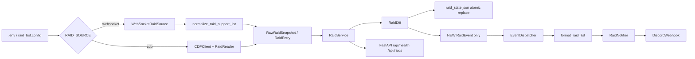
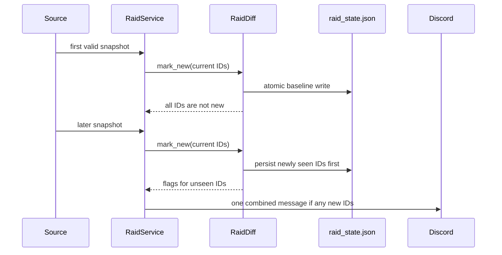

# 開發者架構圖

## Raid Bot source 切換

### WebSocket source

`raid_bot/infrastructure/websocket_raid_source.py` 負責：

1. 連線 `RAID_WS_ENDPOINT`。
2. 處理遊戲 WebSocket protocol 的 handshake、ACK 與 ping/pong。
3. 送出 `register` 與定時 `raid_get_support`。
4. 只接受 `raid_support_list`。
5. 將已驗證欄位轉成 `RaidEntry`：

| WebSocket | Domain |
| --- | --- |
| `prf_code` | `profound_id` / Raid ID |
| `prf_name` | `boss` |
| `prf_mons` | `monster_code` |
| `prf_founder` | `founder` |
| `prf_hp` | `hp` / `hp_max` |
| `prf_member` | `participant_count` / `member_limit` |
| `prf_limit` | `expires_at` |

Normalizer 會移除 HP 與人數中的千分位逗號。格式錯誤的單次
payload 會被拒絕，不會使整個 source 停止。

### CDP source

`run_raid_bot.py` 只在 `RAID_SOURCE=cdp` 時 import `CDPClient` 與
`RaidReader`。讀取完成後仍交給相同的 `RaidService`、dispatcher、
formatter 與 notifier。

### Diff 與持久化

`seen_ids` 是累積集合，不會因 Raid 從當前 snapshot 消失而刪除。
因此 HP 更新、人數更新與消失後再出現都不會形成新通知。

### API 與 process lifecycle

`run_raid_bot.py` 先驗證設定，建立 source 與既有 Discord notifier，
再將 `RaidService.run_forever()` 掛在 FastAPI lifespan。關閉時取消
service task，而 service 的 `finally` 會關閉 source。

`/api/health` 從 service 讀取：

- `source`
- `connected`
- 最新 snapshot 的 `raid_count`
- `last_update`
- 去敏感的 `last_error`

API 不會回傳 owner ID 或 Discord webhook。

## Bonus Navigator

Bonus Navigator 是與 Raid Bot 分離的桌面流程：

```mermaid
flowchart LR
    STEAM["Steam / UNLIGHT desktop"] --> CDPPORT["CDP 127.0.0.1:59222"]
    CDPPORT --> SNIFFER["ULSniffer"]
    SNIFFER --> CONTEXT["Auto-attached context containing window.game"]
    CONTEXT --> BONUS["window.game.scene.keys.Bonus"]
    BONUS --> TABLE["In-game WS client fetch db_bonusgame"]
    TABLE --> GUI["Tkinter target / position / inventory UI"]
    GUI --> CONFIG["Injected __ULR_BONUS_NAVIGATOR__"]
    CONFIG --> ACTIONS["Bonus button events"]
```

`ULSniffer` 會讀取 `http://127.0.0.1:59222/json/version`，連到其
`webSocketDebuggerUrl`，對 Electron targets 啟用 auto-attach，並在已發現的
execution contexts 中逐一探測 `window.game.scene.keys`。

GUI 每 700 ms 查詢位置、running state、停止原因與道具庫存。
自動控制在遊戲 context 內以 `__ULR_BONUS_NAVIGATOR__` 保存，GUI
本身沒有狀態檔。

## 安全邊界

- Raid API 只能綁定 localhost。
- owner ID 與 webhook 只從環境讀取。
- Raid state 只保存 Raid ID，不保存原始 payload。
- WebSocket Raid formatter 不執行未驗證的星級、碎片或獎勵推測。
- Bonus Navigator 可觸發遊戲操作並消耗道具，不應當作純監看器。
- Bonus Navigator 沒有 Extension import，但依賴遊戲 runtime 內的
  `window.game` 與現有 WebSocket client constructor。

