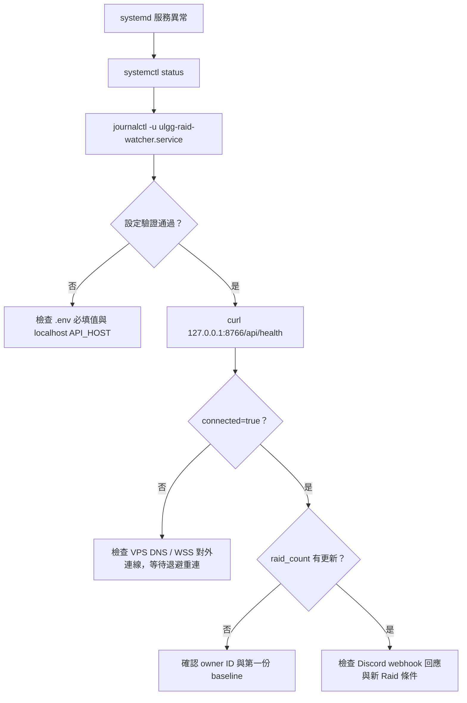
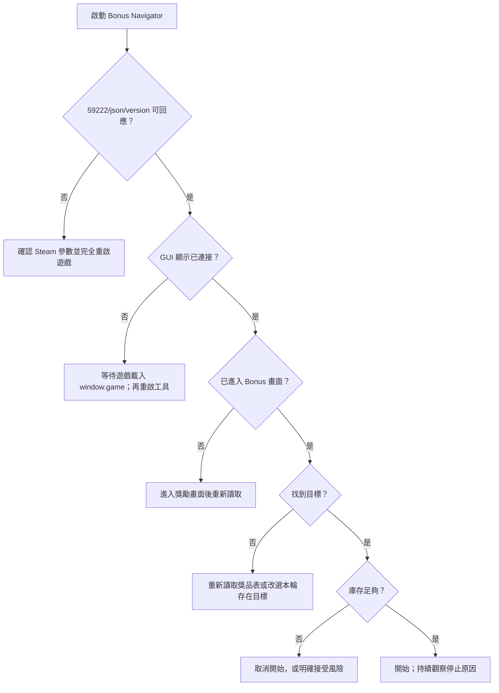

# 問題排查流程

## Raid VPS Watcher



### 服務無法啟動

```bash
sudo systemctl status ulgg-raid-watcher.service
sudo journalctl -u ulgg-raid-watcher.service -n 100 --no-pager
sudo -u ulgg test -r /opt/ulgg-raid-bot/.env
sudo -u ulgg test -w /opt/ulgg-raid-bot/data
sudo -u ulgg /opt/ulgg-raid-bot/.venv/bin/python /opt/ulgg-raid-bot/detector/run_raid_bot.py
```

常見設定錯誤：

- `RAID_SOURCE` 只能是 `websocket` 或 `cdp`。
- WebSocket 模式的 endpoint 必須以 `wss://` 開頭。
- WebSocket 模式必須有 `RAID_OWNER_ID`。
- 兩種 source 都必須有 `DISCORD_WEBHOOK_URL`。
- `RAID_INTERVAL` 必須大於 0。
- `API_HOST` 只能是 `127.0.0.1` 或 `localhost`。

### Health API 無法連線

```bash
curl --verbose http://127.0.0.1:8766/api/health
sudo ss -ltnp | grep 8766
```

若 `.env` 改了 `API_PORT`，`curl` 也要使用同一個 port。Health API
不會對外網路綁定，因此不應從其他電腦直接連 VPS 的
`8766` port。

### `ok=true` 但 `connected=false`

`ok` 只表示 API 活著。`connected=false` 表示 source 目前沒有有效
WebSocket 連線。程式會以 2、5、10、30、60 秒上限的序列重連。

檢查 VPS 是否可進行 DNS 查詢、是否允許 WSS 對外連線，以及
`RAID_WS_ENDPOINT` 是否仍是預期值。日誌只顯示錯誤類型，
不會顯示 owner ID 或 endpoint 中的敏感內容。

### 有 Raid 但沒有 Discord 通知

1. 確認這不是服務啟動後的第一份有效 snapshot。
2. 確認該 `prf_code` 沒有存在 `raid_state.json` 的
   `seen_raid_ids`。
3. 確認這不只是 HP 或人數更新。
4. 檢查 journald 是否有 Discord HTTP status。
5. 確認 webhook 仍有效且 VPS 可連 Discord。

不要為了強制通知而直接刪除 state。刪除後下一份清單只會成為
新 baseline，不會補發當前 Raid。

### 收到錯誤格式後服務仍在運作

這是預期行為。單次格式錯誤會被記錄並忽略，source 會繼續等待
後續事件。

## Bonus Navigator



### `CDP 連線失敗`

```powershell
Invoke-RestMethod http://127.0.0.1:59222/json/version
Get-NetTCPConnection -LocalPort 59222 -State Listen
```

若無法回應：

1. 確認 Steam 啟動選項是 `--remote-debugging-port=59222`。
2. 完全關閉遊戲進程，再由 Steam 啟動。
3. 確認 59222 沒有被其他程式占用。

Bonus Navigator 本身不會為遊戲加上啟動參數。

### `找不到包含 window.game 的 execution context`

CDP endpoint 可用不等於遊戲 runtime 已完成載入。先等待遊戲進入
可操作畫面，再關閉並重新啟動 Bonus Navigator。`ULSniffer`
會搜尋所有已 attach context，不是依靠固定 frame 編號。

### `找不到 Bonus 場景` / `請先進入獎勵畫面`

登入遊戲後進入 HIGH／LOW Bonus 畫面，然後按「重新讀取本輪
獎品」。`Bonus` 場景存在但 `id` 還沒有建立時，GUI 會顯示
「請先進入獎勵畫面」。

### `找不到遊戲連線物件`

獎品表讀取需要從 Bonus、Result、Lobby、MainA、Initialize、
Unlight_Init、ConnectionCheck 或 Raid 場景中取得有 `fetch` 的
socket。GUI 現有提示為先回大廳再進入。

### `目前沒有進行中的獎勵遊戲`

`db_bonusgame` 沒有回傳可用 `items`。確認當前 Bonus 局仍在進行，
然後按「重新讀取本輪獎品」。

### `本輪獎品表中找不到這個目標`

只會搜尋目前位置或之後的獎品。目標已經在後方、本輪不存在，
或獎品表還沒有重新讀取時，都可能出現這個提示。

### `救援道具不足`

自動流程會停止，不會繼續盲目操作。骰差大於 5 時只會選擇
跳越星；不會誤用花5。補足庫存後，重新確認目標再手動開始。

### 遊戲關閉或 CDP 斷線

GUI 會顯示「已與桌面版中斷」與「請重新啟動本工具」。現行
Bonus Navigator 沒有自動重連，請關閉 GUI，確認遊戲與 CDP 已復原後
再重開。
