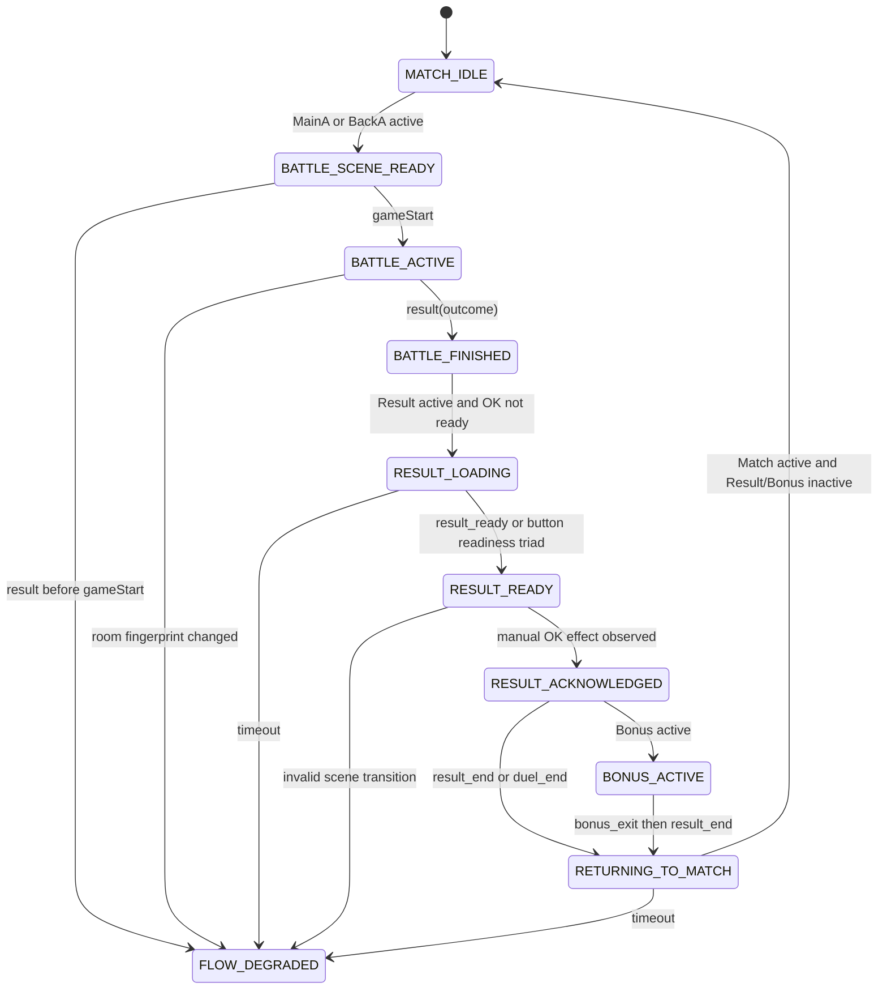

# Battle Flow State Machine v0.1

狀態：Design only

資料來源：`battle_state_probe.log`（2026-08-05）

範圍：被動判斷 Steam Client 的 Battle → Result → Bonus/Match 流程

非範圍：自動 click、socket emit、加入房間、戰鬥操作、渦2或花3策略

## 1. Log 結論

- 共 159 筆 JSONL，159 筆皆可解析。
- 唯一一輪可識別流程使用同一個遮罩房間：`room#1c5549bc47ea59a6`。
- 權威事件只有一組 `gameStart` 與 `result(win)`。
- `gameStart`（02:01:30.473 UTC）至 `result`（02:01:31.136 UTC）只有約 0.66 秒，兩者被同一個一秒 snapshot 收錄。
- 沒有觀察到 `endPhase` 或 `endTurn`，因此本 log 不能證明正常長戰的 move/attack/defense 順序。
- RESULT 在約 5.35 秒後發出 `result_ready`；此時 `btn_ok.visible=true`、`alpha=1`、`input.enabled=true`。
- 手動按 OK 沒有獨立 allowlisted 事件。其效果可由下一筆 `alpha: 1 → 0`，以及再下一筆 `Bonus` scene active 推定。
- Bonus 結束時依序觀察到 `bonus_exit → result_end → duel_end`。
- `duel_end` 另在下一秒重複出現一次，需要去重。
- 回到 Match 後 log 的 `phase` 仍是 `result`，是 reducer 殘留值，不是 Match 的真實 phase。

## 2. 兩層狀態模型

v0.1 不把 Phaser scene 當成戰鬥權威。狀態分成兩層：

1. **Lifecycle state**：只由 `gameStart`、`result`、Result/Bonus 結束事件推進。
2. **Presentation state**：由 active scenes、Result button 狀態描述目前畫面。

權威規則：

- `gameStart` 是唯一權威戰鬥開始。
- `result` 是唯一權威戰鬥結束。
- `MainA` active 但未收到 `gameStart` 只能算 `BATTLE_SCENE_READY`。
- 收到 `result` 後，即使 `DrawPhaseA/MainA` 尚未關閉，lifecycle 也必須是 `BATTLE_FINISHED`。
- `Result`、`Bonus` scene 只決定結果流程的 presentation substate。
- 完整 room ID 永不進入狀態或 log；cycle identity 只使用 room fingerprint。

## 3. State 定義與允許 action

此處的 action 是狀態機輸出的「可用意圖」，不是 probe 會執行的操作。v0.1 probe 永遠只能觀察。

| State | 進入條件 | 可允許 action | v0.1 執行權限 |
|---|---|---|---|
| `MATCH_IDLE` | Match active，且沒有未結束 battle cycle | `WAIT_FOR_ROOM`；未來可提出 `REQUEST_JOIN_FRIEND_ROOM` | 僅等待；加入房間禁用 |
| `BATTLE_SCENE_READY` | MainA/BackA active，但尚未收到本 cycle 的 `gameStart` | `WAIT_FOR_GAME_START`、`OBSERVE_SCENE` | 被動 |
| `BATTLE_ACTIVE` | 收到本 cycle 的權威 `gameStart`，尚未收到 `result` | `OBSERVE_PHASE`、`OBSERVE_TURN`、`WAIT_FOR_RESULT` | 被動 |
| `BATTLE_FINISHED` | 收到有效 `result(win/lose/draw)` | `WAIT_FOR_RESULT_SCENE`、`RECORD_OUTCOME` | 被動 |
| `RESULT_LOADING` | Result active，但 OK 尚未 ready | `WAIT_FOR_RESULT_READY` | 被動 |
| `RESULT_READY` | Result active，且 `result_ready` 或 OK readiness triad 成立 | `MANUAL_RESULT_OK` | 僅提示；自動 click 禁用 |
| `RESULT_ACKNOWLEDGED` | 曾為 ready，之後 OK alpha 降為 0；尚未確認下一 scene | `WAIT_FOR_BONUS_OR_EXIT` | 被動推定 |
| `BONUS_ACTIVE` | `Bonus` 出現在 active scenes，即使 `Result` 仍 active | `HANDOFF_TO_BONUS_NAVIGATOR`、`WAIT_FOR_BONUS_EXIT` | 僅交接狀態；不改 Bonus 策略 |
| `RETURNING_TO_MATCH` | `bonus_exit`、`result_end` 或第一個有效 `duel_end` | `WAIT_FOR_MATCH` | 被動 |
| `FLOW_DEGRADED` | 事件順序違反權威規則、room fingerprint 改變、必要 state timeout | `STOP_AUTOMATION`、`COLLECT_SAFE_DIAGNOSTIC` | Fail closed |

任何 state 都不允許 probe 執行：

- `Result.btn_ok.emit/click`
- `socket.emit/send/fetch`
- `scene.start/launch/stop`
- 加入或建立房間
- 戰鬥輸入

## 4. State transition



### 4.1 實測 lifecycle transition

| Transition | Log 證據 | 判定 |
|---|---|---|
| `MATCH_IDLE → BATTLE_SCENE_READY` | line 99→100，`Match → MainA` | Scene-only，尚非權威開始 |
| `BATTLE_SCENE_READY → BATTLE_ACTIVE` | line 112 event，`gameStart` | 權威開始 |
| `BATTLE_ACTIVE → BATTLE_FINISHED` | line 112 event，`result=win` | 權威結束；與 gameStart 同 snapshot |
| `BATTLE_FINISHED → RESULT_LOADING` | line 115→116，Result active，OK alpha 0 | Presentation transition |
| `RESULT_LOADING → RESULT_READY` | line 122，`result_ready`，OK triad 全 true | 可提示手動 OK |
| `RESULT_READY → RESULT_ACKNOWLEDGED` | line 122→123，OK alpha 1→0 | 手動 click 效果推定，不等同捕捉 click |
| `RESULT_ACKNOWLEDGED → BONUS_ACTIVE` | line 124 active scenes 出現 Bonus/BonusDice/BonusRoll | Result 仍 active，不能只看 primary scene |
| `BONUS_ACTIVE → RETURNING_TO_MATCH` | line 156，`bonus_exit → result_end → duel_end` | 結果流程結束 |
| `RETURNING_TO_MATCH → MATCH_IDLE` | line 157，Match active，Result/Bonus inactive | 新 cycle 可開始 |

### 4.2 實測 raw phase transition

| From | To | Log 證據 | 解讀 |
|---|---|---|---|
| `none` | `battle` | line 99→100 | MainA 載入；未收到 gameStart |
| `battle` | `draw` | line 111→112 | DrawPhaseA active |
| `draw` | `battle` | line 112→113 | Draw scene 關閉；但 result 已先收到 |
| `battle` | `result` | line 115→116 | Result scene active |
| `result` | `result`（raw） | line 156→157 | 錯誤殘留；normalized phase 應為 `none` |

本次未觀察到以下 phase，不能宣告已驗證：

- `move`
- `attack`
- `defense`
- `attack_dice`
- `defense_dice`
- `attack_result`
- `defense_result`
- `endPhase` payload
- `endTurn` payload

## 5. Guard 與優先序

### 5.1 Lifecycle 優先序

由高至低：

1. `result` event
2. `gameStart` event
3. `bonus_exit/result_end/duel_end`
4. Result/Bonus active scene
5. Battle phase active scene
6. Match/Lobby scene

`result` 已出現時，不得因 MainA/DrawPhaseA 尚 active 而退回 `BATTLE_ACTIVE`。

### 5.2 RESULT ready guard

可進入 `RESULT_READY` 的安全條件：

```text
Result active
AND result in {win, lose, draw, timeup}
AND (
  observed result_ready
  OR (
    btn_ok.visible == true
    AND btn_ok.alpha > 0
    AND btn_ok.input.enabled == true
  )
)
```

不得單獨使用 `input.enabled` 判定 ready；實測手動 OK 後它仍為 true，但 alpha 已為 0。

### 5.3 Bonus guard

`Result` 在 Bonus 期間仍保持 active，且 primary scene 因優先序仍顯示 Result。因此 `BONUS_ACTIVE` 必須檢查完整 `active_scenes` 是否含 `Bonus`，不能只看 `scene` 欄位。

### 5.4 Cycle reset

回到 Match 且 Result/Bonus 均 inactive 時：

- current phase 清為 `none`
- current result 清為 `none`
- outcome 移到 `last_result`
- room fingerprint 清除
- 新 cycle 必須等待新的 `gameStart`

## 6. TODO

### P0：建立 state machine 前必做

- [ ] 將 lifecycle 與 presentation state 分開儲存；避免 active MainA 覆蓋已收到的 `result`。
- [ ] 將事件逐筆 reduce，不要只在每秒 snapshot 合併後判斷。必須保留同一 snapshot 內 `gameStart → result` 的順序。
- [ ] 回到 Match 時清除 current phase/result，另存 `last_result`，修正 raw `phase=result` 殘留。
- [ ] 判斷 Bonus 時改看 `active_scenes`，不能使用 Result 優先的單一 `scene`。
- [ ] 對 `duel_end` 去重。去重 key 只能使用安全 metadata，不能保存 room ID、token 或 transport payload。
- [ ] 定義 cycle key：建議 `room_fingerprint + gameStart timestamp`，不可只用 room fingerprint。
- [ ] 所有 `gameStart` 前的 phase/result socket event fail closed，不得建立 active battle。
- [ ] 為每個 state 加 timeout；timeout 進 `FLOW_DEGRADED`，不得自動操作。

### P1：補齊實機資料

- [ ] 錄製一場正常長戰，覆蓋 Draw → Move → Attack/Defense → Dice → Result。
- [ ] 確認 `endPhase args[0]` 的實際字串集合與方向。
- [ ] 確認 `endTurn args[0]` 的實際 turn 語意與起始值。
- [ ] 分別錄製 win、lose、draw；timeup 已由先前 smoke 看過，但本 log 是 win。
- [ ] 錄製無 Bonus 的 RESULT OK 路徑：`result_ready → result_end → duel_end`。
- [ ] 錄製有 Bonus 的 RESULT OK 路徑：`result_ready → Bonus active → bonus_exit → result_end → duel_end`。
- [ ] 確認 duel_end 重複是多 CDP target 重複觀察，還是遊戲真的送出兩次。
- [ ] 驗證斷線、投降、維護、timeup 對 result/outcome 的差異。

### P2：未來 Winner Flow（本版禁用）

- [ ] 將 observer 與 command executor 分成不同元件；observer 不得取得 click/socket emit 能力。
- [ ] `RESULT_READY` 只發布 `MANUAL_RESULT_OK_AVAILABLE`，不自動 click。
- [ ] `MATCH_IDLE` 的加入好友房 action 必須另行設計、審核與授權。
- [ ] Bonus handoff 只傳 lifecycle/cycle identity，不得修改既有渦2與花3策略。
- [ ] 每個未來 action 必須具備 idempotency、cycle guard、timeout 與 fail-closed 行為。

## 7. v0.1 驗收準則

- 同一筆 snapshot 含 `gameStart`、`result` 時，最終 lifecycle 必須是 `BATTLE_FINISHED`。
- `result` 前沒有 `gameStart` 時，必須進 `FLOW_DEGRADED` 或忽略，不得宣告 battle finished。
- Result OK 尚未 ready 時不得發布 `MANUAL_RESULT_OK_AVAILABLE`。
- Bonus active 時，即使 Result 仍 active，也必須進 `BONUS_ACTIVE`。
- 回到 Match 後 current phase 不得保留 `result`。
- 重複 `duel_end` 不得讓 cycle 完成兩次。
- 狀態輸出不得包含完整 room ID、socket args、token 或其他 transport payload。
- v0.1 不得執行任何遊戲 action。
